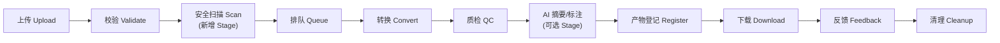
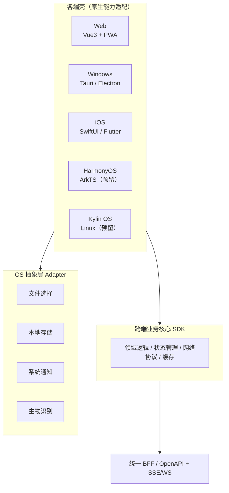
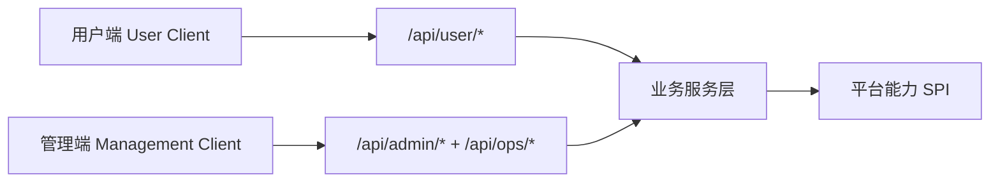
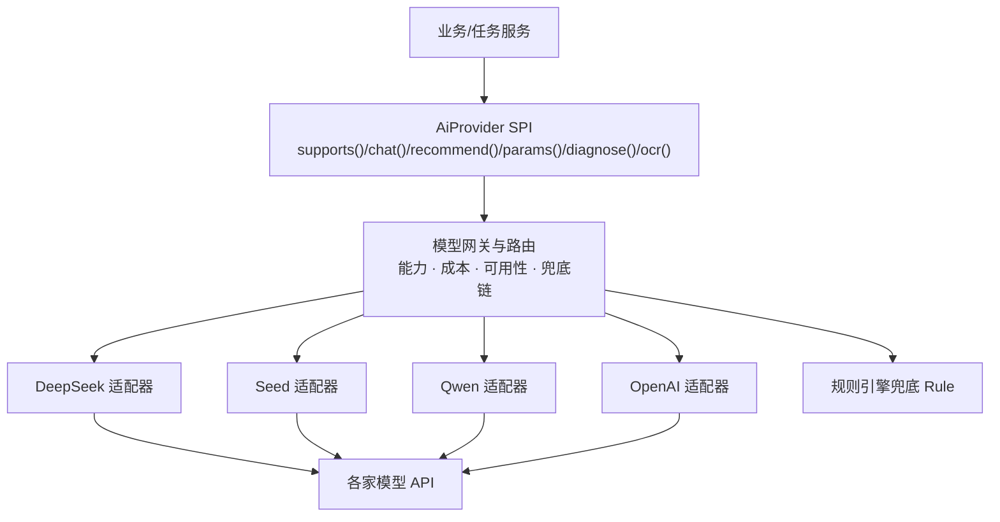
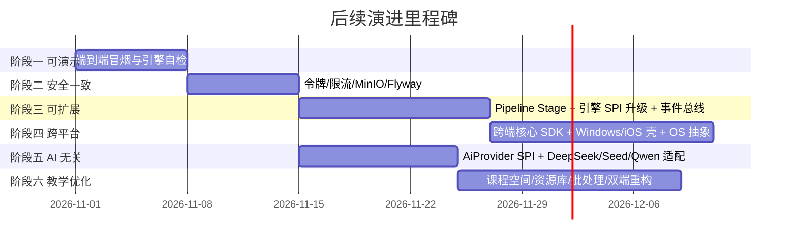

# 后续项目工作流设计（校园课程资源格式适配与转换服务系统）

> 依据：2026.10.27 中期审计结论 + 项目说明书 + 需求文档 + 中期新增五项架构原则
> 目标：在"可构建、可测试、可真实转换"的半成品之上，演进为**可插拔、跨平台、双端、模型无关、面向教学**的平台

---

## 一、总体演进路线

以既有路线图（阶段一~四）为基础，按五项原则新增三条主线，合并为六个阶段：

| 阶段 | 主线 | 关键交付 | 对应原则 |
|---|---|---|---|
| 一 | 可演示闭环 | Compose 端到端冒烟、引擎自检 | 基线 |
| 二 | 安全与一致性 | 下载令牌、限流、MinIO、Flyway | 基线 |
| 三 | **可扩展管线** | Pipeline Stage 抽象、引擎 SPI 升级、模块拆分 | ① |
| 四 | **跨平台多端** | 跨端核心 SDK、Windows/iOS 壳、OS 抽象层 | ② |
| 五 | **AI 无关** | AiProvider SPI、多模型适配器与降级链 | ④ |
| 六 | **教学优化 + 双端** | 课程空间、资源库、批处理、双客户端重构 | ③⑤ |

阶段三/四/五可并行推进，阶段六依赖前三者。

---

## 二、目标逻辑架构（分层 + 可插拔）

```mermaid
flowchart TB
  subgraph Clients["客户端接入层（多端 + 双客户端）"]
    UC["用户端 User Client<br/>Web / Windows / iOS"]
    MC["管理端 Management Client<br/>Web / Windows / iOS"]
  end
  subgraph Edge["接入与网关层"]
    GW["统一 API 网关 / BFF<br/>鉴权 · 限流 · 路由 · OpenAPI · SSE/WS"]
  end
  subgraph App["应用服务层（模块化）"]
    direction LR
    AUTH["认证授权"]
    FILE["文件"]
    TASK["任务"]
    TPL["格式模板"]
    QUOTA["配额"]
    NOTIFY["通知"]
    AUDIT["审计"]
    STATS["统计"]
    FEEDBACK["反馈"]
    COURSE["课程/资源库<br/>(新增)"]
  end
  subgraph Core["领域核心"]
    PIPELINE["可编排任务管线 Pipeline<br/>校验→排队→转换→质检→...→清理"]
    SM["状态机 TaskStatusEnum"]
    EV["事件总线 EventBus"]
  end
  subgraph Platform["平台能力层（SPI 可插拔）"]
    ENG["引擎 SPI ConversionEngine"]
    QC["质检 SPI QcChecker"]
    STORE["存储 SPI StorageService"]
    QUEUE["队列 SPI TaskQueue"]
    AI["AI 提供方 SPI AiProvider"]
    NOTIF2["通知 SPI Notifier"]
    SCHED["调度/锁 SPI Scheduler + Lock"]
  end
  subgraph Data["数据层"]
    MYSQL[("MySQL")]
    REDIS[("Redis")]
    OSS[("对象存储 Local/MinIO")]
  end

  Clients --> GW --> App --> Core --> Platform --> Data
```



**关键变化**：把"引擎 SPI"这一种扩展点，泛化为**六类平台能力 SPI**，并把 TaskDispatcher 内部的硬编码顺序重构为**可编排管线**。

---

## 三、原则一：可扩展性与可伸缩性

### 3.1 转换引擎 SPI 升级（已有 `ConversionEngine` 基础上增强）

```java
// 现状：getType() / supports() / convert() / healthCheck()
// 升级为“能力声明式”：
interface ConversionEngine {
    EngineType type();
    EngineCapability capability();          // 支持的源/目标、并发度、超时、GPU/CPU
    boolean supports(String sourceExt, String targetExt);
    ConvertTask convert(ConvertTask task, String sourcePath, String targetPath);
    boolean healthCheck();
}
```

新增能力：
- **参数 Schema 自动校验**：`FormatTemplate.paramsSchema` 驱动前端表单 + 后端参数校验，避免引擎内散落解析。
- **灰度与权重**：`EngineRegistry` 支持同一格式多引擎竞争路由（如 LibreOffice vs Pandoc），按健康度/成本/速度打分选路。
- **引擎热插拔**：新引擎仅需实现接口 + `@ConditionalOnProperty` 注册，无需改动分发代码。

### 3.2 工作流"管线 Stage"抽象（核心改造）

把 `TaskDispatcher` 的固定顺序拆成可编排阶段，每个阶段一个接口：

```java
interface PipelineStage {
    String name();
    StageResult process(TaskContext ctx);   // CONTINUE / SKIP / FAIL / TERMINATE
}
// 内置：ValidateStage, EnqueueStage, ConvertStage, QcStage,
//       RegisterStage, NotifyStage, CleanupStage, FeedbackStage
```



**收益**：新增"病毒扫描、水印、转码后 AI 摘要、权限审核"等阶段只需实现 `PipelineStage` 并注册到配置，即可插入流程任意位置——满足"插入新工作流阶段"的要求。

### 3.3 模块化与伸缩性

- **模块化**：按领域拆分为可独立部署的服务模块（auth/file/task/engine/scheduler/gateway），接口先行、事件解耦。
- **事件总线**：`TaskCreated / TaskConverted / TaskFailed / FileExpired / QuotaExceeded` 等领域事件，供新模块订阅，避免点对点耦合。
- **伸缩**：引擎计算与 Web 服务分离（无状态 Web 可水平扩容；引擎 worker 独立扩缩），配合分布式锁（ShedLock）避免多实例调度冲突。
- **配置中心 + 特性开关**：`campus.plugin.*` 统一管理模块启停与灰度。

---

## 四、原则二：跨平台兼容

### 4.1 客户端分层（业务逻辑与平台壳解耦）



### 4.2 关键设计

- **核心 SDK**：把鉴权、任务轮询、格式推荐、上传/下载等业务逻辑下沉为与平台无关的核心层（TypeScript/JS 可被 Web/Electron/Tauri 复用）。
- **OS 抽象层（Adapter）**：定义 `FilePicker / LocalStorage / Notification / Biometric` 接口，各端提供实现；HarmonyOS 用 ArkTS 实现 Adapter，Kylin OS 复用 Linux/Electron 实现，**业务代码零改动**。
- **协议统一**：所有端只依赖 `OpenAPI 3.1` 契约 + `SSE/WebSocket` 推送；后端永不返回端相关字段。
- **渐进策略**：先完成 Web（PWA 可"安装"）+ Windows（Tauri 打包现有 Vue），再出 iOS（Flutter 共享 Dart 业务层），HarmonyOS/Kylin 仅需新增壳。

---

## 五、原则三：双客户端架构



| 维度 | 用户端 User Client | 管理端 Management Client |
|---|---|---|
| 使用者 | 学生、教师/助教 | 课程管理员、运维、系统管理员 |
| 核心功能 | 上传/转换/下载、任务、历史、反馈、AI 助手、课程空间 | 用户/角色/配额、格式模板、统计报表、审计日志、引擎/队列/存储监控、清理维护 |
| 交互侧重 | 轻量、引导式、拖拽、批量、进度 | 数据密集、表格/图表、批量操作、告警 |
| 权限 | STUDENT / TEACHER | COURSE_ADMIN / OPS / SYS_ADMIN |
| 部署 | 可独立发布的端（应用商店/PWA） | 可独立发布的后台端 |

设计要点：
- **同一套核心 SDK、两套壳**，避免重复实现；仅路由与权限菜单不同。
- **API 严格隔离**：`/api/user`、`/api/admin`、`/api/ops` 分前缀 + 方法级 `@PreAuthorize`；管理端接口默认拒绝普通用户。
- **共享组件库**：表格、表单、状态徽章、图表在双端复用，仅装配不同。

---

## 六、原则四：AI 无关集成

### 6.1 目标：把"AI 提供方"彻底抽成可插拔 SPI

现状 `AiService` 只有 rule/llm 两个 `@ConditionalOnProperty` 实现，缺乏多模型能力。重构为：



### 6.2 关键设计

- **统一 `AiProvider` 接口**：`enabled() / supports(Capability) / chat() / recommendFormats() / recommendParams() / diagnose() / ocrAndSummarize()`，每个模型一个适配器，声明自己的能力矩阵与价格。
- **模型注册表 + 路由**：配置驱动（`campus.ai.providers.deepseek.base-url/api-key/model`…），按任务类型（推荐/诊断/OCR/客服）、成本上限、健康状态选择模型。
- **降级链**：`DeepSeek → Seed → Qwen → 规则引擎` 逐级 failover，任何模型不可用都不阻断核心转换（延续既有"可降级"理念）。
- **提示词模板库**：与业务解耦，各模型共享同一套 prompt 模板与参数 Schema，保证跨模型输出一致。
- **评估与审计**：记录每次调用（模型、耗时、token、成本、结果），支持 A/B 评估与成本核算。

---

## 七、原则五：用户为本（教学场景优化）

### 7.1 面向学生

- **作业提交格式适配**：识别老师要求的交付格式，提交前自动转好、附合规校验。
- **一键转交**：转换结果直接回填到课程作业区，减少手动下载/上传。
- **批量转换**：文件夹/多文件一次入队，统一进度条。
- **历史归档**：按课程归档，到期前提醒，避免过期丢失。

### 7.2 面向教师

- **课件多格式分发**：一次上传，自动生成 PDF/图片/音频多版本供不同终端使用。
- **作业批改格式统一**：学生提交物自动规范为统一格式，便于批阅与存档。
- **审核/批注**：对转换结果做在线批注与反馈回传。
- **评分表与统计**：按班级/课程统计提交与转换情况。

### 7.3 平台级体验优化

- **课程空间**：以"课程"组织文件、任务、成员（新增 domain + 双端页面）。
- **实时进度**：SSE/WebSocket 推送任务状态（替代轮询）。
- **无障碍与体验**：暗色模式、多语言（i18n）、键盘导航、移动端适配。
- **消息中心**：站内通知升级为可订阅的事件通知。

---

## 八、扩展点与接口契约清单（落地索引）

| 扩展点 | 接口 | 切换/注册方式 | 现状 | 目标 |
|---|---|---|---|---|
| 转换引擎 | `ConversionEngine` | `EngineType` + `@ConditionalOnProperty` | 3 个 impl | 能力声明 + 灰度 + 热插拔 |
| 工作流阶段 | `PipelineStage`（新增） | 配置编排 | 硬编码顺序 | 可插拔管线 |
| 存储 | `StorageService` | `campus.storage.type` | local / MinIO(占位) | MinIO 落地 + 多云 |
| 队列 | `TaskQueue` | `campus.queue.provider` | redis | +Kafka/RabbitMQ |
| 质检 | `QcChecker` | `campus.engine.qc.provider` | rule / ai | 多算法 + 评分 |
| AI | `AiProvider`（重构） | `campus.ai.providers.*` | rule / llm | DeepSeek/Seed/Qwen/OpenAI 多适配器 |
| 通知 | `Notifier`（新增） | `campus.notify.provider` | 站内 | 站内/邮件/短信/推送 |
| 调度/锁 | `Scheduler + Lock` | `campus.schedule.lock` | 单机定时 | ShedLock 分布式 |
| 认证 | `IdpProvider`（预留） | `campus.auth.provider` | 本地账号 | 学校统一认证（SSO/CAS） |
| 端适配 | `OS Adapter`（新增） | 端侧实现 | 仅 Web | Windows/iOS/HarmonyOS/Kylin |

**领域事件**：`TaskCreated / TaskQueued / TaskConverted / TaskFailed / TaskDownloaded / FileExpired / QuotaExceeded / UserRegistered`，供新模块订阅。

---

## 九、里程碑与任务分解



| # | 任务 | 验收标准 | 原则 |
|---|---|---|---|
| 1 | Compose 端到端冒烟 + 引擎健康自检 | 四服务健康，注册→上传→转换→下载跑通 | 基线 |
| 2 | 下载令牌一次性校验 + 接口限流 + MinIO 落地 + Flyway | 令牌过期/跨用户 403；超限返回 1011；`storage.type=minio` 可用 | 基线 |
| 3 | `PipelineStage` 抽象 + 内置阶段重排 | 新增"安全扫描"阶段零改动插入；引擎能力声明生效 | ① |
| 4 | 事件总线 + 模块拆分 + 分布式锁 | 新模块可订阅事件；多实例调度不重复 | ① |
| 5 | 跨端核心 SDK + Windows(Tauri) + iOS(Flutter) | 三端共用同一业务逻辑；OS Adapter 可替换 | ② |
| 6 | HarmonyOS/Kylin 适配器预留 | 接口 + 文档就绪，可增量实现 | ② |
| 7 | `AiProvider` SPI + DeepSeek/Seed/Qwen 适配器 | 配置切换模型；降级链生效；调用可审计 | ④ |
| 8 | 双客户端重构 + 管理端独立发布 | 用户端/管理端分离，权限矩阵生效 | ③ |
| 9 | 课程空间 + 资源库 + 批处理 + 实时进度 | 以课程组织文件；批量转换；SSE 推送 | ③⑤ |
| 10 | 无障碍/多语言/暗色 + 端到端/集成/并发测试 | 测试通过；i18n 覆盖 | ⑤ |

---

## 十、风险与验收

| 风险 | 对策 |
|---|---|
| 管线重构破坏现有状态机 | 逐阶段灰度，状态机 CAS 保持不变，全量回归测试 |
| 多端投入大 | 优先 Web(PWA) + Windows(Tauri 复用 Vue)，iOS/HarmonyOS 采用 Flutter 共享业务层 |
| 多模型适配差异大 | 统一 AiProvider 契约 + prompt 模板 + 评估，输出规范化 |
| 模块化过度设计 | 以"先接口、后拆服务"渐进，避免一次性微服务化 |
| 数据一致性 | 事件最终一致 + 对账任务 + 幂等消费 |

**整体验收（Definition of Done）**：在"可构建、可测试、可真实转换"基础上，达成——① 新引擎/新阶段零改动接入；② Web/Windows/iOS 三端可用、HarmonyOS/Kylin 适配接口就绪；③ 用户端/管理端分离且权限隔离；④ DeepSeek/Seed/Qwen 配置即切换、可降级；⑤ 师生教学闭环（课程空间、批处理、实时进度）上线。
