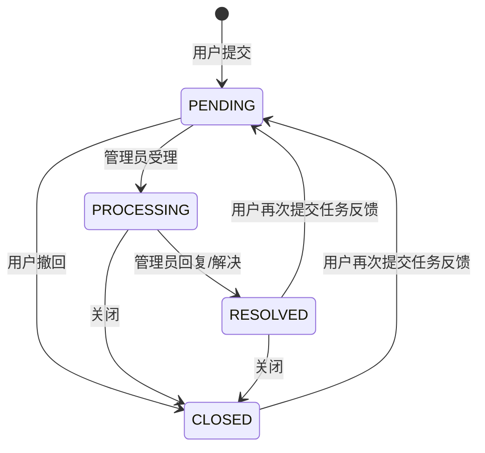

# 多格式转换与反馈模块 API 设计

> 适用范围：多格式转换服务（m4s→mp4、ncm→mp3、HEIC、Pages、CAJ、字幕、MOV/HEVC、CAJ/DjVu、公式/OCR）+ 完整反馈模块（用户端 + 管理端）
> 基础路径：`/api`（`server.servlet.context-path=/api`）
> 鉴权：`Authorization: Bearer <JWT>`（除登录/注册/文档外均需登录）

---

## 一、通用约定

### 1.1 统一响应

```json
{ "code": 200, "message": "success", "data": { } }
```

### 1.2 关键业务码

| code | 含义 |
|---|---|
| 200 | 成功 |
| 400 | 参数错误 |
| 401 | 未登录/令牌失效 |
| 403 | 无权限 |
| 404 | 资源不存在 |
| 1001 | 今日配额已用尽 |
| 1002 | 文件过大 |
| 1003 | 格式不支持 |
| 1008 | 任务状态非法 |
| 1010 | 存储空间不足 |
| 1011 | 请求过于频繁（预留） |

---

## 二、多格式转换能力 API

### 2.1 获取全部转换能力

`GET /api/formats`

响应 `data`：

```json
{
  "total": 30,
  "formats": [
    {
      "sourceExt": "m4s",
      "targetExt": "mp4",
      "engine": "FFMPEG",
      "category": "video",
      "paramsSchema": {
        "mode": { "type": "enum", "default": "auto", "enum": ["auto", "remux", "transcode"] },
        "crf": { "type": "integer", "default": 23, "min": 18, "max": 32 }
      },
      "available": true
    }
  ],
  "grouped": {
    "video": [ ... ],
    "audio": [ ... ],
    "image": [ ... ],
    "document": [ ... ],
    "subtitle": [ ... ],
    "ocr": [ ... ]
  }
}
```

`available=false` 表示当前环境缺少对应引擎/外部工具（如未安装 caj2pdf、pix2tex），不影响其他能力。

### 2.2 按源格式查询目标格式

`GET /api/formats/{sourceExt}`

示例：`GET /api/formats/ncm` → 返回 `ncm→mp3`、`ncm→flac`。

### 2.3 上传文件格式识别

`POST /api/formats/detect`（`multipart/form-data`，字段名 `file`）

响应 `data`：

```json
{
  "filename": "photo.heic",
  "detectedExt": "heic",
  "targetExts": ["jpg", "png", "webp"],
  "options": [ { "sourceExt": "heic", "targetExt": "jpg", "engine": "IMAGEMAGICK", "available": true } ]
}
```

识别顺序：**魔数优先，扩展名兜底**（支持 PNG/JPEG/FLAC/WAV/NCM/DjVu/PDF/OGG/MP3/HEIC）。

### 2.4 创建转换任务

`POST /api/tasks`

```json
{
  "sourceFileId": 12,
  "targetFormat": "mp4",
  "params": { "mode": "auto", "crf": 23 }
}
```

其余任务接口保持不变：`GET /api/tasks`、`GET /api/tasks/{id}`、`POST /api/tasks/{id}/cancel`、`POST /api/tasks/{id}/retry`、`GET /api/tasks/{id}/download`。

### 2.5 支持的转换矩阵

| 源格式 | 目标格式 | 引擎 | 依赖 | 备注 |
|---|---|---|---|---|
| m4s / mov / hevc / mkv | mp4 | FFMPEG | ffmpeg | 优先 `-c copy`，失败回退 H.264/AAC |
| ncm | mp3 / flac | NCM | 无（纯 Java 解密） | 解密后同格式直出，否则 ffmpeg 转码 |
| heic / heif | jpg / png / webp | IMAGEMAGICK | ImageMagick + libheif | 需构建含 HEIC delegate |
| pages | pdf | PAGES | 外部转换器 | 需配置 `campus.engine.pages-command` |
| caj | pdf | CAJ | caj2pdf | 可选引擎 |
| djvu / djv | pdf | DJVU | DjVuLibre (`ddjvu`) | 可选引擎 |
| srt / vtt / ass / ssa | srt / vtt / ass | SUBTITLE | 无（纯 Java） | 解析→统一 Cue→序列化 |
| png / jpg / jpeg / heic | txt / latex | FORMULA_OCR | Tesseract / pix2tex | `latex` 走 pix2tex，`txt` 走 Tesseract |
| doc / docx / ppt / pptx | pdf | LIBREOFFICE | LibreOffice | 支持 CJK 字体 |
| flac / wav / m4a | mp3 | FFMPEG | ffmpeg | 码率 128k/192k/256k/320k |
| png / jpg / jpeg | webp | IMAGEMAGICK | ImageMagick | quality 10–100 |

### 2.6 引擎配置项

```yaml
campus.engine:
  ffmpeg-path: ffmpeg
  libreoffice-path: soffice
  imagemagick-path: convert
  caj2pdf-path: caj2pdf
  ddjvu-path: ddjvu
  pages-command: ""
  tesseract-path: tesseract
  tesseract-lang: chi_sim+eng
  pix2tex-path: pix2tex
  task-timeout-minutes: 30
```

---

## 三、反馈模块 API

### 3.1 数据模型

| 字段 | 类型 | 说明 |
|---|---|---|
| id | Long | 主键 |
| taskId | Long | 关联任务（通用反馈为空） |
| userId | Long | 提交用户 |
| category | String | BUG/FEATURE/CONTENT/EXPERIENCE/OTHER |
| title | String | 标题（≤120） |
| rating | Integer | 评分 1–5（任务反馈可选） |
| comment | String | 反馈内容（≤1000，必填） |
| contact | String | 联系方式（可选） |
| anonymous | Boolean | 是否匿名 |
| status | String | PENDING/PROCESSING/RESOLVED/CLOSED |
| adminReply | String | 管理员回复 |
| repliedBy | Long | 回复管理员 |
| repliedAt | DateTime | 回复时间 |
| createdAt / updatedAt | DateTime | 时间 |

**状态流转**：



### 3.2 用户端接口

#### 提交反馈

`POST /api/feedback`

```json
{
  "taskId": 12,
  "rating": 5,
  "category": "BUG",
  "title": "转换后缺页",
  "comment": "第 3 页表格丢失",
  "contact": "student@example.com",
  "anonymous": false
}
```

- `taskId` 为空 → 通用反馈；
- `taskId` 非空 → 必须是本人任务；同一任务重复提交会更新原反馈并重新置为 `PENDING`。

响应：`FeedbackResponse`。

#### 我的反馈列表

`GET /api/feedback/mine?pageNum=1&pageSize=10&status=PENDING&category=BUG&keyword=缺页`

响应：`PageResponse<FeedbackResponse>`。

#### 反馈详情

`GET /api/feedback/{id}`（仅本人）

#### 撤回反馈

`POST /api/feedback/{id}/withdraw`（仅 `PENDING` → `CLOSED`）

#### 按任务查看

`GET /api/feedback/task/{taskId}?pageNum=1&pageSize=10`（本人或管理/运维）

### 3.3 管理端接口

> 权限：`SYS_ADMIN` / `COURSE_ADMIN` / `OPS`

#### 反馈列表

`GET /api/admin/feedback?pageNum=1&pageSize=10&status=PENDING&category=BUG&keyword=缺页&rating=5`

响应包含 `username`；匿名反馈显示为“匿名用户”。

#### 统计

`GET /api/admin/feedback/stats`

```json
{
  "total": 42,
  "pending": 8,
  "processing": 5,
  "resolved": 25,
  "closed": 4,
  "avgRating": 4.3,
  "byCategory": { "BUG": 12, "FEATURE": 9, "OTHER": 21 }
}
```

#### 详情

`GET /api/admin/feedback/{id}`

#### 回复

`POST /api/admin/feedback/{id}/reply`

```json
{ "reply": "已定位为字体缺失，下次转换将使用内嵌字体。", "status": "RESOLVED" }
```

#### 修改状态

`PUT /api/admin/feedback/{id}/status`

```json
{ "status": "PROCESSING" }
```

---

## 四、前端页面

| 页面 | 路由 | 说明 |
|---|---|---|
| 用户反馈中心 | `/feedback` | 提交反馈（分类/评分/任务/匿名）、我的反馈、详情、撤回 |
| 管理端反馈 | `/admin/feedback` | 统计卡片、筛选、列表、状态快捷修改、详情抽屉、回复 |

- 用户端：`web/src/views/FeedbackView.vue`
- 管理端：`web/src/views/AdminFeedbackView.vue`
- API 封装：`web/src/api/feedback.js`
- 常量：`web/src/utils/constants.js`（`FEEDBACK_CATEGORY/STATUS/STATUS_TYPE`）

---

## 五、数据库迁移

新库：直接执行 `deploy/schema.sql`（已包含新字段与新格式模板）。

已有库：执行增量脚本

```bash
mysql -u root -p campus_convert < deploy/schema-v2-multiformat-feedback.sql
```

该脚本会：
1. 为 `feedback` 增加 `category/title/contact/anonymous/status/admin_reply/replied_by/replied_at/updated_at` 及索引；
2. 将 `task_id` 改为可空、`comment` 改为必填；
3. 插入多格式转换模板（`INSERT IGNORE`）。

---

## 六、可选引擎与降级说明

- **CAJ / DjVu / Pages / OCR** 依赖外部工具，标记为 `optional`：未安装时 `/api/formats` 中 `available=false`，不会拖垮系统整体健康检查。
- **NCM / 字幕** 为纯 Java 实现，不依赖外部二进制，开箱即用。
- 转换失败会返回可读原因（如“请确认已安装 pix2tex”“Pages 转换器未配置”），并清理半成品文件。
